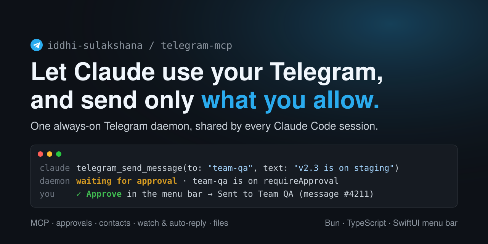
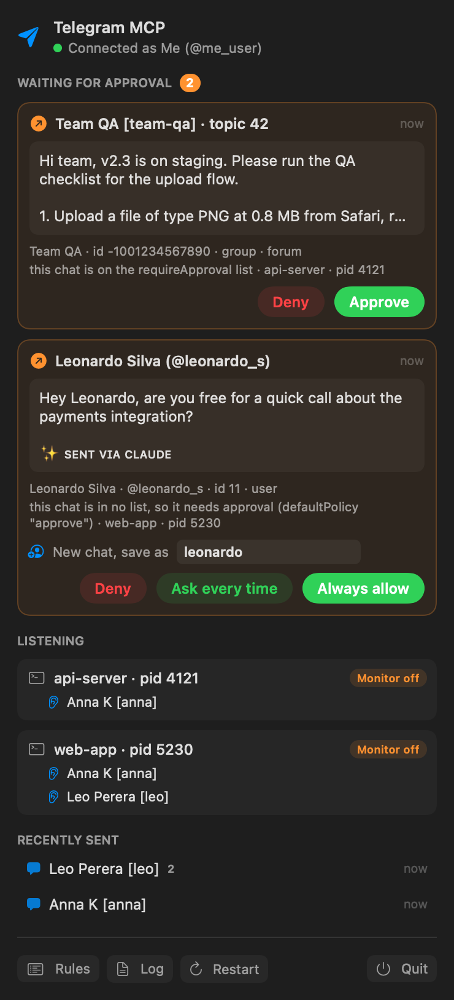
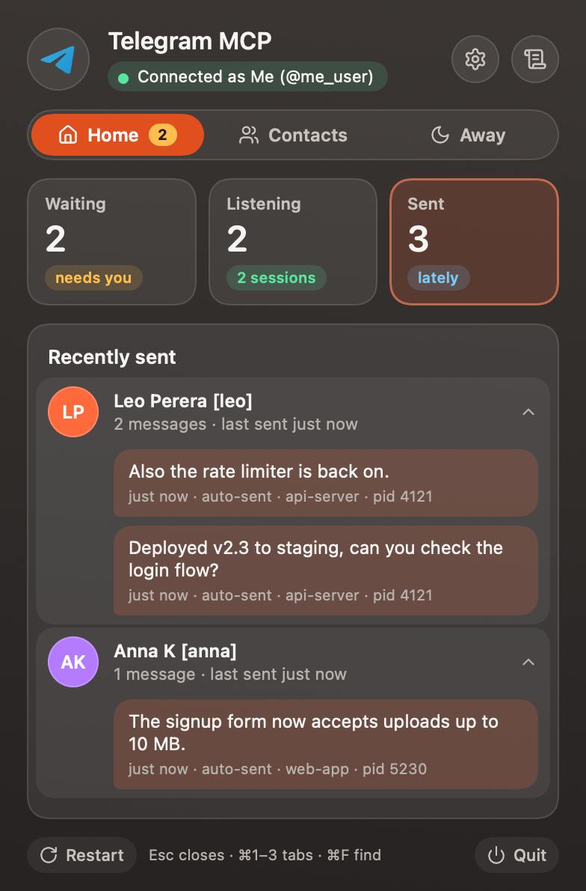
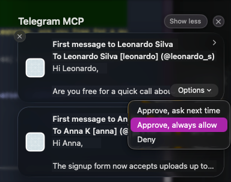
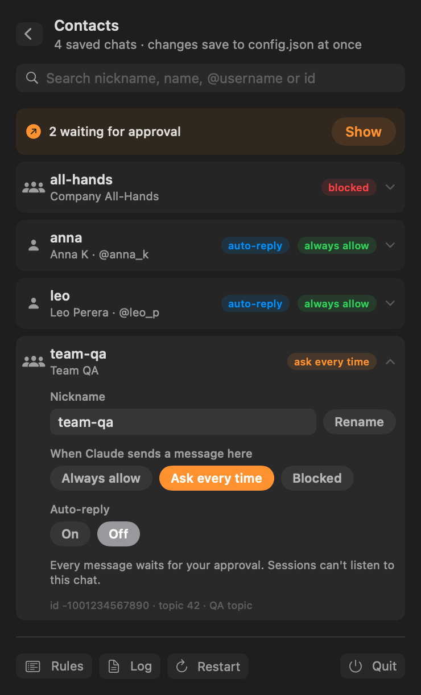

<p align="center">
  
</p>

# telegram-mcp

Telegram for Claude Code, through **one always-on daemon** instead of a Telegram connection per session.

```
Claude session A ─┐ stdio                                   
Claude session B ─┼─ tgmcp mcp (thin proxy, no Telegram) ── WebSocket ──► tgmcp daemon ──► Telegram
Claude session C ─┘                                          127.0.0.1      (launchd, KeepAlive)
```

- **The daemon** (`tgmcp daemon`) runs under launchd, starts at login, and is restarted if it ever exits. It holds the only Telegram connection (your user account, via [mtcute](https://mtcute.dev)), reads the rules file, and keeps every session's watches.
- **The proxy** (`tgmcp mcp`) is what Claude Code launches for each session. It has no Telegram connection. It forwards tool calls to the daemon, and if the daemon restarts it reconnects by itself and restores the session's watches. It never exits over daemon trouble, so Claude Code never marks the server "failed" and you never have to `/mcp reconnect`.

## Staying connected without a human

- mtcute reconnects dropped sockets by itself.
- A watchdog pings Telegram every 30 s and rebuilds the client when two pings fail, when it has been stuck "connecting" for 90 s, or straight after the Mac wakes from sleep. Rebuilds retry forever, backing off up to a minute.
- Messages that arrive while the connection is down are caught up after it reconnects (mtcute's update gap recovery), and each one is delivered only once.
- A tool call made during a reconnect waits up to ~25 s for the connection instead of failing.
- If the daemon process dies, launchd restarts it within 5 s. The proxies reconnect and re-register their watches.
- Only a revoked or missing login stops it, because that needs you: `tgmcp login`.

## Setup

Install a prebuilt binary. On macOS and Linux it goes into `~/.local/bin`, and on macOS the menu bar app goes into `~/Applications`. On Windows, `tgmcp.exe` and the tray app go into `%LOCALAPPDATA%\Programs\tgmcp`, which is added to your PATH:

```sh
curl --proto '=https' --tlsv1.2 -LsSf https://github.com/iddhi-sulakshana/telegram-mcp/releases/latest/download/tgmcp-installer.sh | sh
```

```powershell
powershell -ExecutionPolicy Bypass -c "irm https://github.com/iddhi-sulakshana/telegram-mcp/releases/latest/download/tgmcp-installer.ps1 | iex"
```

or run it from a checkout with [Bun](https://bun.sh): `bun install && bun link` puts `tgmcp` on your PATH (or use `bun run src/cli.ts …`). Then:

```sh
tgmcp install                     # launchd agent: starts the daemon now and at every login
tgmcp login                       # in a terminal: api_id/api_hash (if not saved yet), phone, code, 2FA
                                  # (tgmcp login --credentials to enter api_id/api_hash again)
tgmcp menubar                     # menu bar app (macOS) or tray app (Windows): approvals, listening sessions, recent sends, contacts (starts at login)
tgmcp mcp-add                     # prints the `claude mcp add` command for your paths
tgmcp status
```

`tgmcp install` (the launchd agent) is macOS-only. On Linux, run `tgmcp daemon` from a systemd user service (or any way that keeps it running). On Windows, keep `tgmcp daemon` running in a terminal. `tgmcp menubar` starts the menu bar app on macOS and the [tray app](#tray-app-windows) on Windows. Everything else works the same.

**Upgrading** a release: run the installer again, then `tgmcp install && tgmcp menubar` to restart both on the new version. Each new version is a new program to macOS, so it asks once more whether tgmcp and "Telegram MCP" may use the "telegram-mcp" Keychain item: choose **Always Allow**. **Moving from a checkout to a release**: `tgmcp install` points the launchd agent at whichever `tgmcp` runs it, so check `which tgmcp` (a `bun link` in `~/.bun/bin` may come first on your PATH), then run `tgmcp install`, `tgmcp menubar` and `tgmcp mcp-add` again. Your config, login and secrets stay where they are.

`tgmcp call <tool> '<json>'` runs any tool as a one-off session, e.g. `tgmcp call telegram_get_rules`.

API credentials come from `TELEGRAM_API_ID` / `TELEGRAM_API_HASH` if set, otherwise the OS keystore (`tgmcp login` saves them there). Get them at https://my.telegram.org → API development tools.

## Secrets

Nothing secret is kept in a plain file. Three secrets go to the operating system's keystore through `Bun.secrets`, under the service `telegram-mcp`: the login Keychain on macOS, Credential Manager on Windows, and the Secret Service (GNOME Keyring, KWallet, via libsecret) on Linux.

| Secret | What it is |
| --- | --- |
| `session-key` | Encrypts the Telegram auth key inside `session.db` (AES-256-GCM) |
| `token` | Shared secret for the local API, so web pages and other users can't talk to the daemon |
| `credentials` | api_id / api_hash |

**Why the session key matters.** A Telegram auth key *is* your login: whoever copies it is you, with no code and no 2FA asked. `session.db` still holds the peer cache and update state, but its auth key rows are sealed with `session-key`. A copy of the folder alone (a backup, a synced dotfiles repo, a stolen disk image, or an infostealer that grabs `~/.config`) doesn't give anyone your account.

**What it doesn't stop.** Code that runs as you and asks the keystore can still get the secrets. On macOS the Keychain only hands them silently to the app that created them, which is the `bun` binary, so any script you run with `bun` could read them. On Linux and Windows any process in your session can. The keystore protects the secrets at rest. It doesn't sandbox your own account.

**Upgrading from an older version.** On its first start the daemon moves `token` and `credentials.json` into the keystore, checks they read back, and deletes the files. It seals the auth key in `session.db` and scrubs the old copy (secure delete, `VACUUM`, WAL truncated). The token value stays the same, so the Monitor URLs of running sessions keep working. Proxies and the menu bar app started before the upgrade still look for the file: run `/mcp` → reconnect in open Claude sessions and `tgmcp menubar` once. The unsealed key may still sit in older backups. To retire it, end the session in Telegram (Settings → Devices) and run `tgmcp login` again.

**The menu bar app** reads the token from the Keychain itself. The first time, and again after each rebuild (`tgmcp menubar`), macOS asks whether "TelegramMCPBar" may use the "telegram-mcp" item: choose **Always Allow**.

**No keystore?** On a machine without one (a headless Linux box, say), set `TELEGRAM_MCP_SECRET_STORE=file` for the daemon, the proxies and the CLI. The secrets then go to `token`, `credentials.json` and `session.key` in the home folder, mode 0600. There is no automatic fallback: if the keystore fails, the error says so instead of quietly writing files. `tgmcp status` shows where the secrets are and warns about leftover plain files.

## Files

All in `~/.config/telegram-mcp/` (folder mode 0700; override with `TELEGRAM_MCP_HOME`):

| File | What |
| --- | --- |
| `config.json` | The rules file (below). Edits apply as soon as you save. A broken edit keeps the last good version and shows up in `tgmcp status`. |
| `session.db` | mtcute's session: peer cache, update state, and the auth key sealed with `session-key` |
| `daemon.log` | The daemon log (`tgmcp logs`) |
| `recent.json` | The last 20 sent messages (shown in the menu bar) |
| `token`, `credentials.json`, `session.key` | Only with `TELEGRAM_MCP_SECRET_STORE=file` |

The daemon listens on `127.0.0.1:47823` (`TELEGRAM_MCP_PORT`).

Downloads go to `~/Downloads/telegram-mcp/<chat>/` (`TELEGRAM_MCP_DOWNLOADS`), named `<message id>-<file name>`.

## The rules file

```jsonc
{
  "guides": ["Free-text rules every session sees when it connects."],
  "footer": "\n\n✨ sᴇɴᴛ ᴠɪᴀ ᴄʟᴀᴜᴅᴇ",        // appended to every message, once
  "defaultPolicy": "approve",                // chats in no list: "approve" or "block"
  "rules": {
    "blocked":         [5550001111],         // never send
    "requireApproval": ["team-qa"],          // always ask you first ("Ask every time")
    "autoSend":        ["me", "@someone"],   // send without asking ("Always allow")
    "autoReply":       ["leo"]               // sessions may listen to these chats and reply without asking
  },
  "chats": {
    "leo": { "id": 123456789, "username": "leo_example", "name": "Leo Perera", "aliases": ["leonard"] },
    "team-qa": { "id": -1001234567890, "name": "Team QA", "topicId": 42 }
  }
}
```

**Lists** take a nickname, an `@username`, a numeric id, or `"me"`. If a chat is on more than one list, the safer list wins: blocked > requireApproval > autoSend > autoReply > defaultPolicy. `blocked` matches the raw id, so `5550001111` also blocks `-1005550001111`.

**/reply** hands one chat to the session that called `telegram_answer_reply`, for two hours or until `/reply stop`. Typing `/reply` in that chat counts as your approval, so the session's replies there go out without asking even when the chat is on `requireApproval`; `blocked` still refuses, and files still ask. Only a `/reply` you type on your phone or desktop counts: messages the daemon sent itself are ignored, and Claude cannot send a message that starts with `/reply`, formatted or not.

**autoReply** chats are the ones Claude sessions may listen to. A session subscribes with `telegram_watch` and stays subscribed until it says stop. Every incoming message from that chat goes to every subscribed session, and each one decides how to reply (the auto reply happens on the Claude side). While subscribed, a session's replies to that chat go out without approval, unless the chat is also on `requireApproval` or `blocked`.

**Files to a watched chat always ask**, even when the chat is on `autoSend`. While a session watches a chat it acts on what people there write, so "send me that file" may be their request, not yours. Text replies still follow the lists. Files to an `autoSend` chat that the session isn't watching go out without asking. Taking a chat off the list stops delivery at once.

**First message to a new chat.** A chat that is on neither `autoSend` nor `requireApproval` always needs approval. The approval also asks what should happen next time:
- **Always allow** puts it on `autoSend`.
- **Ask every time** puts it on `requireApproval`.

Approving also saves the chat under `chats`, with a suggested nickname you can edit: the first name, else the username, else the full name. From then on the chat follows that list. Only you put chats on the lists, through an approval or the menu bar's [Contacts page](#contacts); sessions can't.

**Approval** happens in the first place available:
1. The **menu bar app**, when it's running. The draft appears there and as a notification. Both offer Approve / Deny, or Deny / Ask every time / Always allow for a new chat. The Claude tool call waits for your click: Claude Code backgrounds it after 2 minutes, and the result arrives when you decide.
2. A **Claude Code dialog** showing the exact recipient and text, plus the next-time choice and nickname for a new chat.
3. **In chat**: the tool returns an approval id. The model must ask you before it calls `telegram_confirm_send`, passing your next-time choice as `remember`.

Nothing is sent unless you accept. Drafts expire after 20 minutes. The rules are checked again at send time.

**Nicknames** (`chats`) let "send to leo" mean exactly one person. Only exact matches resolve: a nickname, an alias, a saved full name, a username or an id. A near match like "leon" is refused with suggestions, never picked. Before every send the daemon checks that the saved id still has the saved username. If either has changed, it refuses until the entry is re-saved. Sessions can add, update and remove nicknames (`telegram_save_chat`, `telegram_remove_chat`). They cannot change `rules`, `footer` or `guides`, and they cannot repoint, create or remove a name that the rules use: only you can, by editing the file or renaming it on the [Contacts page](#contacts).

## Tools

| Tool | |
| --- | --- |
| `telegram_status` | connection, account, config errors, this session's watches |
| `telegram_get_rules` | guides, footer, lists, saved nicknames |
| `telegram_list_chats` | recent chats with unread counts and what sending there would do |
| `telegram_search_chats` | find a person or group to save |
| `telegram_read_messages` | read a chat or forum topic |
| `telegram_send_message` | send, following the rules |
| `telegram_send_file` | send a local file with a caption, following the same rules (but see files to watched chats, above); credentials and this tool's own files are always refused |
| `telegram_send_sticker` | re-send a sticker someone posted (by chat and message id), following the same rules; stickers take no caption, so no footer |
| `telegram_page` | page the user for something that needs a human now: the desktop rings until they ack, and the phone gets a push (see [Pages](#pages)) |
| `telegram_answer_reply` | make this session answer `/reply`: type `/reply` (or `/reply <what to say>`) in any chat from your own account and that chat is handed to the session; `/reply stop` takes it back |
| `telegram_download_media` | save a message's file, photo, video or voice note and return the path |
| `telegram_confirm_send` / `telegram_cancel_send` | approval fallback for clients without dialogs |
| `telegram_save_chat` / `telegram_remove_chat` | manage nicknames |
| `telegram_watch` / `telegram_unwatch` | subscribe to an autoReply chat (optionally one sender, one topic) |
| `telegram_get_events` | collect watched messages nobody pushed yet |
| `telegram_mark_read` | mark a chat read |

## Watching ("tell me when Leo replies")

`telegram_watch` subscribes the session to a chat on the autoReply list until it calls `telegram_unwatch` or ends. Each new incoming message reaches every subscribed session once, by the first of these that is available to that session:

1. **Monitor** (the default): `telegram_watch` returns a `ws://127.0.0.1…/events?session=…&key=…` URL, and Claude opens its Monitor tool on it. The key opens that one session's stream and nothing else, so the URL (which Claude Code keeps in its transcripts) never carries the token. Each message becomes a notification in the session. A Monitor stops after 30 minutes, or when the daemon restarts. Claude is told to restart it straight away with the same URL whenever it ends while watches are active (`telegram_status` shows the URL again). Nothing is lost in between, because messages queue up and are flushed when the Monitor reconnects.
2. **Channel push** (optional: `tgmcp mcp --channel`, plus `claude --dangerously-load-development-channels server:<name>`): messages appear in the session by themselves as `<channel>` events, with no Monitor needed. This uses Claude Code's channels research preview.
3. **Queue**: `telegram_get_events` drains it. Every other tool result also mentions when messages are waiting.

A session's watches outlive a daemon restart, because the proxy re-sends them. They also outlive a proxy blip for 5 minutes. They end when the Claude session ends.

## Pages

A page is for something that needs you now: production down, a blocker someone is waiting on, "call me". The menu bar app (macOS) or the tray app (Windows) plays a looping alarm and opens a window above everything, and it keeps ringing until you press **Ack** or **Snooze** (15 minutes or an hour). With a pager bot, your phone gets the page as a push too, with the same buttons. An Ack anywhere stops it everywhere.

Only the daemon decides what pages, from the `paging` section of the rules file:

```jsonc
"paging": {
  "pageFrom": [5550001111],          // numeric user ids whose "/page <reason>" pages you (a username can change hands)
  "vip": ["team-qa"],                // chats where a keyword alone pages you
  "keywords": ["urgent", "down", "prod", "asap"],
  "retryMinutes": 5, "tries": 3,     // phone retries while nobody acks
  "perSenderMinutes": 10             // at most one page per sender in this window
}
```

- **`/page <reason>`** from someone on `pageFrom` pages you. Anyone else's `/page` is ignored, and so is your own.
- **A keyword** (as a whole word) pages you only in a `vip` chat. Elsewhere, "urgent" pages no one.
- **Claude** can page you with `telegram_page`, under the same rate limit.

On the [Contacts page](#contacts), **Can page me** puts a person on `pageFrom` (by their user id) or takes them off, and **Page** sends them `/page <reason>` from your account. It rings them if you're on *their* `pageFrom`, and you get their daemon's replies in that chat.

**Your own alarm sound.** Put `alarm.mp3` (or `.m4a`, `.wav`, `.aiff`, `.caf`) in the home folder and the menu bar app plays it instead of the built-in beep. The tray app plays `alarm.wav` (its sound player takes WAV only). Both look for the file on each new page, so no restart is needed, and both fall back to the beep if the file is missing or unreadable. To make a WAV from an MP3: `ffmpeg -i alarm.mp3 alarm.wav`.

The sender gets fixed replies, never text Claude wrote and never their own reason echoed back: "Paging Leo now. I'll tell you when they've seen it.", "Leo saw it.", and, if nobody acks after the last try on the phone, "Leo hasn't seen it yet. Try calling." The desktop keeps ringing after that. A page only ever notifies you; its reason is shown as text and nothing in it is acted on. Every page, retry, ack and snooze is written to `pages.jsonl` in the home folder (without the reason). Pages live in the daemon's memory, so a restart drops the ones still ringing.

**The phone.** Messages from your own account don't buzz your phone, so pages reach it through a bot of your own:

1. Make one with [@BotFather](https://t.me/BotFather) (`/newbot`), then run `tgmcp page setup` and paste its token. It goes to the keystore.
2. Open the bot, press **Start**, and keep that chat unmuted, or the phone won't buzz.
3. `tgmcp restart`, then `tgmcp page test` to hear the alarm, check the volume and try Ack.

The bot only messages the account you're logged in as, and ignores button presses from anyone else.

## Menu bar app

`tgmcp menubar` builds `menubar/build/Telegram MCP.app` (SwiftUI, no Dock icon) and starts it at login. Choosing Quit keeps it closed until your next login. It shows:

- the connection, with a warning icon when the daemon or Telegram is down
- **Waiting for approval**: the exact text, recipient, reason and asking session, with Approve / Deny. A new chat gets an editable nickname and Deny / Ask every time / Always allow instead.
- **Listening**: each session that is watching chats, and whether its Monitor is connected
- **Recently sent**: the last 5 chats you sent to. Hover a chat to see its messages, when they went, how they were approved, and from which session.
- **Contacts** (the button at the top right): every saved chat, to change its rules without editing `config.json`. See [Contacts](#contacts).

<p>
  
  
</p>

Each new draft also posts a notification, so you can decide without opening the panel. Its **Options** menu has the same choices as the panel: **Approve** / **Deny** for a chat that is already on a list, and **Approve, ask next time** / **Approve, always allow** / **Deny** for the first message to a new chat.



Hover a draft to see all of it. The panel never runs past the bottom of the screen: when a long draft (or many of them) would, the middle scrolls and the header and footer stay put.

The menu bar icon shows the number of drafts waiting. `tgmcp menubar uninstall` removes it.

### Contacts

**Contacts** at the top of the panel lists every saved chat (`chats` in the rules file) with tags for how it's set up. Search by nickname, name, @username or id. Click a chat to change it:

- **Nickname**: type a new one and press Rename. Rules that used the old name are rewritten to the new one, so the chat keeps its lists. A name that already means another chat is refused, and so is a name the rules mention that matches no chat yet (taking it would quietly put this chat on those lists). One of the chat's own aliases can become its nickname.
- **When Claude sends a message here**: **Always allow** (`autoSend`), **Ask every time** (`requireApproval`) or **Blocked** (`blocked`). The chat ends up on exactly that list: every other entry that means the same chat is taken out of the other two, whether it's a nickname, an alias, an id, an @username or `"me"`. A chat on none of them shows as *not set*.
- **Auto-reply**: **On** puts it on `autoReply`, so sessions may watch it and reply without asking. **Off** takes out every entry that means the chat, and sessions watching it stop getting its messages at once. The text under the buttons says when the sending rule overrides this (Ask every time still asks; Blocked still refuses).
- **Can page me** (people only, not groups, bots or yourself): **On** puts their user id on `paging.pageFrom`, so their `/page <reason>` rings you (see [Pages](#pages)). **Off** takes it out. The row gets a *can page me* tag.
- **Page *nickname***: type a reason (or none) and press **Page** or Return. The daemon sends `/page <reason>` to that person from your account, as one line of at most 200 characters and without the footer, since everything after `/page` is their reason. It shows under Recently sent. A chat whose sending rule blocks it (Blocked, or on no list with `defaultPolicy: "block"`) is refused.

Each click saves to `config.json` at once, the same way an approval does: the file is read fresh first, so a hand edit made a moment ago is kept, and a broken file is reported, never overwritten. A click that changes nothing writes nothing. Each change is noted in `daemon.log`. Rules are per chat, so if two nicknames point to the same chat, changing one changes both; the details line under the buttons names the other.



This page is the menu bar's own: it goes through the daemon's local API with the token (`POST /ui/contacts` and `POST /ui/contacts/page`, like approvals). No MCP tool offers the same, so sessions still can't change the rules through the server.

## Tray app (Windows)

On Windows, `tgmcp menubar` starts the tray app and sets it to start at login. Settings → Apps → Startup lists it as "Telegram MCP".

- **From a release**, it uses the prebuilt `TelegramMCPTray.exe` that the installer put next to `tgmcp.exe`. It's self-contained, so it needs no .NET. Set `TELEGRAM_MCP_TRAY_APP` to use one somewhere else.
- **From a checkout**, it first builds `tray/build/TelegramMCPTray.exe` (C#/WPF), which needs the [.NET SDK 10](https://dotnet.microsoft.com/download).

It is the menu bar app's counterpart:

- **The tray icon** is a paper plane, filled while a session is listening. Its badge is the number of drafts waiting, or `!` when the daemon or Telegram is down. Hover it for a summary.
- **Click it for the panel**: the connection, **Waiting for approval** (Approve / Deny; a new chat gets a nickname box and Deny / Ask every time / Always allow), **Listening**, and **Recently sent** (hover a chat to see its messages).
- **Contacts** (top right of the panel) is the same page as the menu bar's (see [Contacts](#contacts) above): rename a saved chat, choose what happens when Claude sends there, turn auto-reply on or off, choose who can page you, and page someone.
- **A Windows notification** for each draft has the same choices as buttons. Click the notification itself to open the panel.

Right-click the icon for Open, Contacts, Rules, Log and Quit. Quit keeps it closed until your next login. `tgmcp menubar uninstall` quits it and stops it starting at login.

It reads the daemon's token from Windows Credential Manager (the `telegram-mcp/token` entry the daemon keeps there), or from the `token` file with `TELEGRAM_MCP_SECRET_STORE=file`. It talks only to 127.0.0.1. Problems it can't show in the panel go to `%LOCALAPPDATA%\TelegramMCPTray\tray.log`.

Nothing supervises the daemon on Windows yet (`tgmcp install` is launchd-only), so keep `tgmcp daemon` running in a terminal. For the same reason the panel has no Restart button.

## Development

```sh
bun test          # unit tests + an end-to-end test that spawns the real proxy against a daemon with a fake Telegram
bun run typecheck
bun scripts/demo-daemon.ts      # daemon with a fake Telegram and sample state, for working on the menu bar app
dotnet run --project tray/Tests # the tray app's logic, and its client against a demo daemon (.NET SDK 10; runs on any OS)
```

The screenshots above come from the demo daemon, rendered offscreen by the app itself:

```sh
APP="menubar/build/Telegram MCP.app/Contents/MacOS/TelegramMCPBar"
export TELEGRAM_MCP_HOME=/tmp/tgmcp-demo TELEGRAM_MCP_PORT=47901 TELEGRAM_MCP_SECRET_STORE=file SNAPSHOT_DARK=1
"$APP" --snapshot docs/menubar-approvals.png
SNAPSHOT_HOVER=recent SNAPSHOT_SCREEN_HEIGHT=4000 "$APP" --snapshot /tmp/history-full.png   # SNAPSHOT_HOVER: 1, approvals or recent
SNAPSHOT_PAGE=contacts SNAPSHOT_OPEN=team-qa "$APP" --snapshot docs/menubar-contacts.png    # SNAPSHOT_OPEN: a nickname to open
```

### Releasing

Releases are built by [`.github/workflows/release.yml`](.github/workflows/release.yml), like key-vault-for-llm's:

1. Set the new version in `package.json` and add a `## <version>` section at the top of [CHANGELOG.md](CHANGELOG.md). It becomes the release's "What's new".
2. Merge that to `main`, then tag it and push the tag:
   ```sh
   git tag v1.2.3 && git push origin v1.2.3
   ```

The workflow runs the tests and `bun scripts/release.ts`. That builds `tgmcp` for Apple Silicon and Intel macOS, x64 and ARM64 Linux, and x64 Windows (`bun build --compile`, so no Bun is needed to run it), plus a universal menu bar app for the macOS archives. It writes a SHA-256 checksum for every file, and the two installers with the version filled in. Each build is then installed with its own installer on its own platform, and the daemon is started there. Only if all of that passes is the GitHub release published. A tag that doesn't match `package.json`, or a version without a CHANGELOG section, stops the build. A tag with a suffix (`v1.3.0-rc.1`) is published as a prerelease. Pull requests that touch these files run the same build and install checks without publishing.

To build locally (the cross-compile downloads Bun for each platform into Bun's install cache):

```sh
bun scripts/release.ts --out /tmp/tgmcp-dist                                # every platform
bun scripts/release.ts --out /tmp/tgmcp-dist --targets aarch64-apple-darwin  # just one
```

## License

MIT. See [LICENSE](LICENSE).
